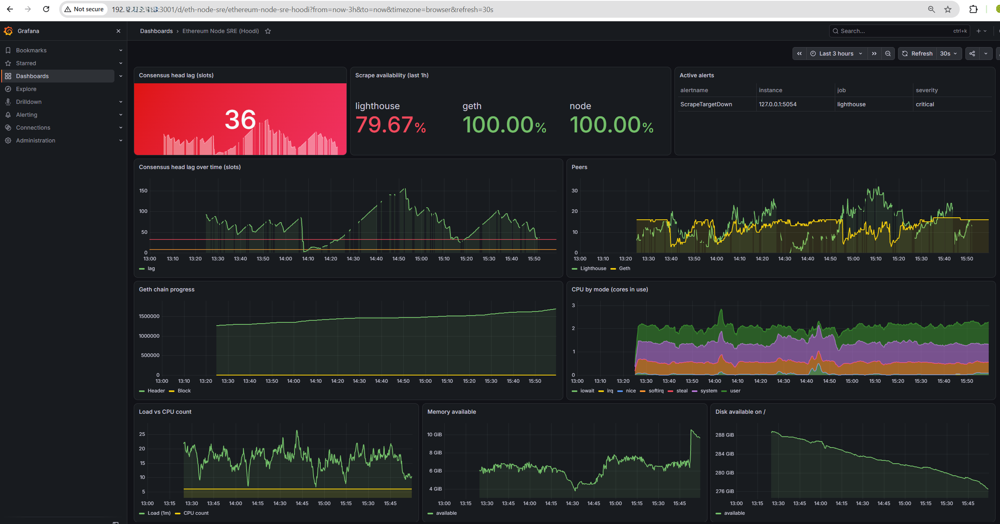
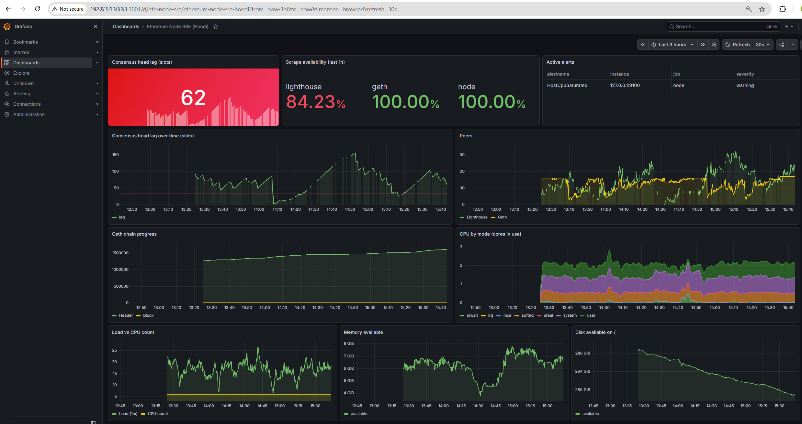
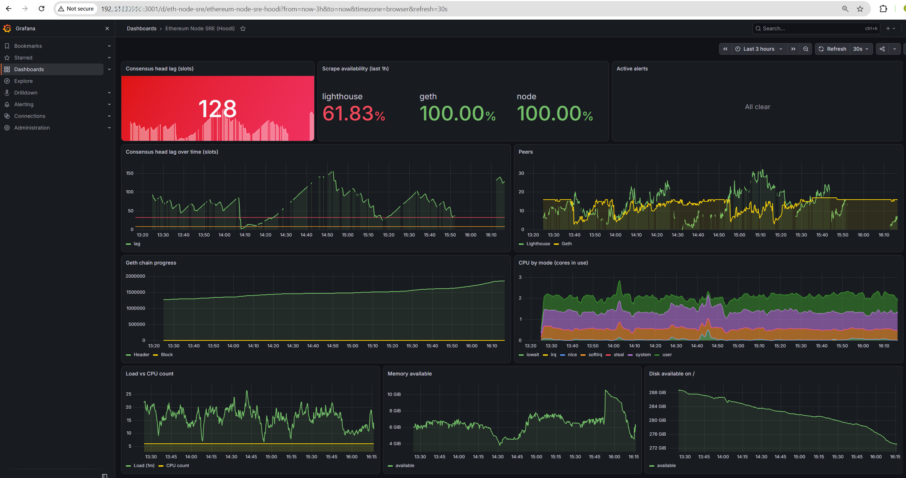

# ethereum-node-sre-lab

Ethereum full node (Geth + Lighthouse) on the Hoodi testnet, with Prometheus, Grafana and alerting. I built it to get hands-on with node operations and to run it the way I'd run a production service: locked-down service accounts, metrics, alerts, a failure drill, and notes on what went wrong.



## Setup

- Ubuntu 25.10 VM on VirtualBox (6 vCPU, 15 GB RAM, 345 GB disk)
- Geth 1.17.10 (execution client)
- Lighthouse 8.3.2 (beacon node, no validator)
- Prometheus, node_exporter and Grafana in Docker Compose

```
peers <--> geth (30303)          peers <--> lighthouse (9000/9001)
              ^                                   |
              |---- Engine API 127.0.0.1:8551 ----|
              |
prometheus scrapes geth :6060, lighthouse :5054, node_exporter :9100
grafana :3001 (host-only network)
```

RPC, the Engine API, metrics and Prometheus only listen on 127.0.0.1. Grafana listens on the VM's host-only address so I can open it from the host machine.

## Security

- Geth and Lighthouse run as separate system users with no login shell and no home directory.
- Each data directory is mode 700 and owned by its client.
- The JWT secret is owned by root, mode 640, readable only by an `ethjwt` group that contains the two service users.

I tested the isolation: each client user gets "Permission denied" on the other's data, my own user can't read the JWT, and both clients can.

## Repo

```
docker-compose.yml
prometheus/prometheus.yml     scrape config
prometheus/alerts.yml         alert rules
grafana/provisioning/         data source + dashboard
scripts/make-dashboard.py     builds the dashboard JSON
scripts/check-targets.py      scrape target health
scripts/check-alerts.py       alert rule states
systemd/                      geth.service, lighthouse.service
host-tuning/                  kernel settings (see below)
docs/                         runbook, screenshots, log excerpts
```

## Dashboard

The dashboard is generated by `scripts/make-dashboard.py`, so it can be rebuilt from the repo.

- Consensus head lag (slots): how far Lighthouse is behind the network right now. Green under 8, orange 8-32, red over 32, same thresholds as the alerts.
- Scrape availability (last 1h): the share of Prometheus's metric collections that succeeded for each target in the past hour. It shows whether I can actually see each component, not whether it's healthy.
- Active alerts: alerts currently going off.
- Consensus head lag over time: the same lag as a graph, with the 8 and 32 slot lines drawn in.
- Peers: how many peers Lighthouse and Geth are connected to.
- Geth chain progress: Header is how far Geth has downloaded block headers. Block is its synced head, which stays at 0 until the initial sync finishes.
- CPU by mode: CPU in use, split by type (user, system, softirq, iowait and so on). This is where the kernel and network overhead showed up during the incident.
- Load vs CPU count: 1-minute load against the number of CPUs (6). Load well above the line means processes are waiting for CPU.
- Memory available and Disk available on /: free memory and free disk space. Disk is the one to watch while the chain syncs.



## Alerts

- ScrapeTargetDown: a metrics endpoint stopped answering
- ConsensusHeadLagging / Critical: Lighthouse more than 8 / 32 slots behind
- ExecutionHeadStalled: Geth's head stopped moving (after initial sync)
- LowConsensusPeers / LowExecutionPeers
- HostCpuSaturated: load over 2x the CPU count for 10 minutes
- DiskSpaceLow and DiskWillFillIn24h (predict_linear over 6h)

## What happened

**Engine API timeouts.** About two hours in, Lighthouse fell 60+ slots behind and kept timing out calling Geth on 8551. I assumed disk I/O at first, but vmstat showed iowait at 1-3%. The CPU was the problem: run queue 16-23 on 6 cores, 3-8% idle, over half the time in the kernel. top showed kcompactd at 60% (proactive memory compaction), heavy softirq from P2P traffic, and a MongoDB and Grafana left running from an older lab.

I stopped the leftover services and set:

```
vm.compaction_proactiveness = 0
/sys/kernel/mm/transparent_hugepage/defrag = defer+madvise
```

Idle CPU went from 3-8% to 63-87% and kcompactd dropped off the list. Both settings are made persistent in `host-tuning/`. The timeouts didn't fully go away: normal RPC calls still answered in 0.14-0.48s, so it looks like the heavier Engine API calls queue behind snap sync work. I left it at that and let monitoring watch it.

**Alert that never fired.** Lag sat above 32 slots for a long time, but ConsensusHeadLagCritical never fired. Lighthouse's scrape success was only 78%. It was too busy to return metrics within Prometheus's 10s timeout, and every missed scrape reset the alert's 10-minute `for` window. I raised the Lighthouse scrape timeout to 14s and it improved to about 95%. The remaining misses are slow responses (slowest 14.67s, no restarts), not outages.

**Failure drill.** I stopped Lighthouse on purpose. ScrapeTargetDown was triggered about 2 minutes later, and the dashboard showed load and memory drop. When I restarted it, Lighthouse resumed from its database, but its metrics took about 7.5 minutes to come back. By then it was 135 slots behind with 4 peers and needed a while longer to catch up. Two takeaways: restarts aren't cheap on this box, and "metrics are back" is not the same as "node is caught up". Also, while Lighthouse was down, the head lag stat kept showing its last value (36), which is why the target-down alert matters. Log: `docs/12-failure-drill.txt`.



## Running it

1. Install Geth and Lighthouse, create the users, directories and JWT secret as described above.
2. Copy `systemd/*.service` to `/etc/systemd/system/` and run `systemctl enable --now geth lighthouse`.
3. Set `GRAFANA_ADMIN_PASSWORD` in the environment before starting the stack (and optionally `GRAFANA_BIND_ADDR`, which defaults to 127.0.0.1). In production this should come from a secrets manager, not a file.
4. `docker compose up -d`, then `scripts/check-targets.py`.
5. Grafana: `http://<bind address>:3001/d/eth-node-sre`

## Still to do

- Geth was still syncing when I wrote this. While it syncs the VM stays CPU-bound and Lighthouse's lag goes up and down in a sawtooth. I expect that to settle after sync, or with more vCPUs.
- After sync: re-check RPC latency, compare my head block with the Hoodi explorer, and run a second drill to trigger ExecutionHeadStalled.
- The node is outbound-only behind NAT. Forwarding the P2P ports would help peer counts but add network load.

Logs in `docs/` have the public IP, enode ID and secrets removed.
